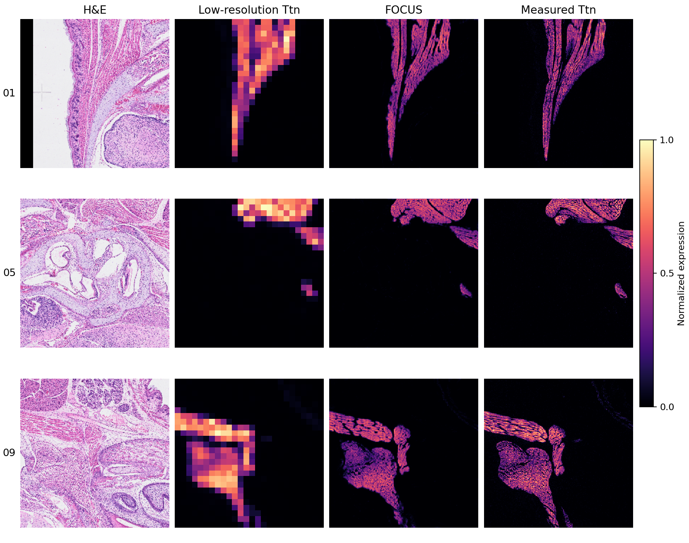

# Coordinated Enhancement of Molecular and Spatial Fidelity for Biological Inference in Spatial Transcriptomics

[](https://www.python.org/downloads/)
[](https://pytorch.org/)
[](LICENSE)

**Open-source license:** FOCUS source code is released under the [MIT License](LICENSE).
Please retain the copyright and license notice when redistributing the code.
Datasets, pretrained weights and third-party components remain subject to their respective
licenses and access conditions; the code license does not replace those terms.

## Overview

Spatial transcriptomics (ST) measures gene expression within tissue, but its capture units impose a trade-off between resolution and sensitivity. Smaller units locate transcripts more precisely but capture fewer molecules. Larger units combine signals from neighbouring cells, blurring tissue boundaries. Correcting these effects separately can leave expression profiles inconsistent with the tissue image or the cells they represent.

FOCUS is a multimodal generative foundation model built on conditional diffusion. It combines native ST with paired haematoxylin and eosin (H&E) images, cell masks, single-cell RNA-sequencing references and spatial co-expression priors. Three task-specific modules address sensitivity, alignment with tissue morphology and cell-level fidelity. A cross-task coordinator compresses active modules into tokens, exchanges information through multi-head cross-attention and uses feature-wise linear modulation (FiLM) to condition each module on the others.

The study trained and evaluated FOCUS across ten ST platforms, 34 tissue contexts and over 1.7 million tissue patches, with more than 5.8 million matched single-cell profiles. Joint enhancement improved performance over treating the tasks separately. Applications examined neutrophil–tumour interactions, spatial osteocyte differentiation and primary–metastatic programmes in head and neck squamous cell carcinoma (HNSCC).


**Figure 1 | Coupled ST limitations and FOCUS overview.** (**a**) Illustration of spatial gene profiling of heterogeneous tissue. (**b**) Three representative coupled limitations: resolution-sensitivity, resolution-alignment, and sensitivity-cell-level fidelity in cellularly dense tissues. (**c**) FOCUS integrates native ST, paired H&E with cell masks, scRNA-seq references and spatial co-expression priors through task-specific modules, coordinated by a cross-task strategy for joint enhancement of resolution, sensitivity, molecular-tissue alignment and cell-level fidelity.

## Repository Structure

```
FOCUS/
├── train.py                     # training entry point
├── train_part.py                # gene-group loop around the training run
├── sample.py                    # inference / evaluation entry point
├── FOCUS.yaml                   # conda environment
├── requirements.txt             # core pip dependencies
├── setup.py / setup.cfg         # package metadata and build configuration
├── pyproject.toml / MANIFEST.in # build backend and source-package contents
├── CONTRIBUTING.md / CHANGELOG.md
├── Dockerfile                   # CUDA container recipe
├── demos/                       # input/, run.py, empty output/
├── docs/                        # usage, algorithm outline and tested environments
├── hooks/ / install-hooks.sh    # optional local whitespace check
├── FOCUS.png / demo_results.png # method overview and demo results
├── config/
│   ├── config_train.yaml        # training hyperparameters
│   └── config_test.yaml         # sampling hyperparameters
├── guided_diffusion/            # the model and the diffusion machinery
│   ├── unet.py                  # diffusion U-Net + the task-specific modules
│   ├── gaussian_diffusion.py    # forward/reverse diffusion and the training objective
│   ├── respace.py               # timestep respacing (used by the '400' test setting)
│   ├── sampler.py               # DPM-Solver utilities
│   ├── load_dataset.py          # multi-class patch dataset + dataloader
│   ├── script_util.py           # model/diffusion factory
│   ├── train_util.py            # TrainLoop
│   └── ...
├── data_preprocessing/          # raw Visium / Visium HD / Xenium -> FOCUS patch layout
│   ├── README.md                # step-by-step preprocessing walkthrough
│   ├── visium/
│   ├── visium_hd/
│   └── xenium/
├── downstream/                  # annotation, deconvolution and trajectory analysis
│   ├── README.md                # what each analysis does and how to run it
│   ├── deconvolution/
│   ├── annotation/
│   ├── matrix/
│   └── trajectory/
├── basic_net/                   # UNet building blocks
├── transform/                   # augmentation / transform helpers
└── assets/                      # figures used by this README
```

### Module Map

The classes in `guided_diffusion/unet.py` are named after the modules and mechanisms of the paper, so the
code can be read alongside the method section:

| Paper | Code |
| --- | --- |
| Reference-guided sensitivity enhancement module | `OTBasedScRNASTFusion` (OT-based scRNA–ST fusion), `SpatialGeneMemoryBank` / `GeneMemoryUpdater` / `SparseGeneMemoryAttention` (gene memory bank over the spatial co-expression matrix), `HEGuidedRegionalAttention`, `SpatialGeneCorrelationWeighting` |
| Morphology-guided alignment module | `ModalityDisentangler`, `MultimodalDisentanglement` |
| Complexity-aware cell-fidelity module | `CellFidelityConstraining` (with `complexity_score` and `select_high_complexity_patch`), `CellCorrelationGraphEncoder` |
| Cross-task coordination | `CrossTaskCoordinator`, `TaskTokenAdapter`, `CrossTaskTokenAttention`, `FiLMModulator` |
| Multimodal pretraining (matching layers) | `SpatialMatchingLayer`, `HEMatchingLayer`, `STMatchingLayer`, `ScalePredictionHead` |
| Prompt / metadata conditioning | `GeneNamePromptProcessor`, `MetadataPromptProcessor`, `SpatialRegionAttention`, `SensitivityNoiseReplacer` |

`UNetModel` is the shared conditional diffusion backbone returned by
`guided_diffusion/script_util.py`. Attribute names such as `self.ot_align`, `self.he_attention`
and `self.lmc` identify these modules within the model. Checkpoints must match the generated gene count:
the current one-gene model cannot load the older five-gene weights.

## Installation

### Environment Setup

The source package is version **0.2.0**. With a supported Python environment and a CUDA-compatible
PyTorch installation, install core dependencies and the package from this checkout:

```bash
python -m pip install torch==2.9.0 torchvision==0.24.0 --index-url https://download.pytorch.org/whl/cu126 --timeout 120
python -m pip install -r requirements.txt --timeout 120
python -m pip install --no-deps .
```

`requirements.txt` lists dependency version ranges. The versions used in our tests are listed below.
The package has not been uploaded to PyPI. Build source and wheel archives with `python -m build`
after installing the `dev` extra. The source archive contains the full scripts, docs and demo data;
the wheel installs the core modules and the demo/config assets under `share/focus/`.

For the preprocessing and downstream scripts, install the additional dependencies:

```bash
python -m pip install ".[preprocessing,downstream]" --timeout 120
```

The original Linux conda environment is also supplied:

```bash
conda env create -f FOCUS.yaml
conda activate focus
```

### Requirements

- Python ≥ 3.10 (the environment pins 3.10.19)
- PyTorch 2.9.0 with CUDA 12.6
- Key dependencies:
  - `scanpy` (1.11.5) — ST data processing
  - `anndata` (0.11.4) — data structures
  - `pot` (0.9.6) — optimal transport
  - `transformers` (4.57.1) — scGPT / metadata BERT integration
  - `timm` (1.0.22) — vision models
  - `mpi4py` (3.1.3) — distributed training

`FOCUS.yaml` records the original training environment.

Preprocessing uses OpenCV for image operations, DuckDB and pyometiff for Xenium, and
SpatialData, spatialdata-io and pyvips for Visium HD. Downstream analysis uses rctd-py,
Tangram, Shapely, OpenSlide, PyArrow, natsort, NetworkX and Scanpy's Leiden dependencies.
Their version constraints are in the `preprocessing` and `downstream` extras in `setup.cfg`.
See [`data_preprocessing/README.md`](data_preprocessing/README.md#2-requirements).

### Tested system and hardware

The demo below was tested on **Ubuntu 20.04.6 LTS**, Python **3.11.15**,
PyTorch **2.12.0+cu126**, torchvision **0.27.0+cu126**, NVIDIA driver **570.133.20**, and one
**NVIDIA RTX 6000 Ada Generation (48 GiB)** on CB4. The supplied `FOCUS.yaml` describes a
different environment (Python 3.10.19 / PyTorch 2.9.0).

The other direct runtime dependencies tested were NumPy 2.4.4, SciPy 1.17.1, Scanpy 1.11.5,
AnnData 0.12.16, Transformers 5.9.0, POT 0.9.7.post1, blobfile 3.3.0,
mpi4py-mpich 3.1.5, scikit-image 0.26.0, PyYAML 6.0.3, pandas 2.3.3,
matplotlib 3.10.9, h5py 3.16.0 and Pillow 12.2.0. The full environment is recorded in
[`docs/environments/linux-cb4.txt`](docs/environments/linux-cb4.txt).

The Windows installation was tested in a new Python **3.12.14** environment on an
**ASUS TUF Gaming A15**, with an **AMD Ryzen 9 7940H**, **48 GB RAM** and
**Windows 10**. It used PyTorch
**2.9.0+cu126**, torchvision **0.24.0+cu126** and Intel MPI **2021.18.1**.
Core installation took **14 min 31 s**, including package downloads and one download retry;
Python, driver installation and model downloads were excluded. Core package versions are in
[`docs/environments/windows-core.txt`](docs/environments/windows-core.txt).

The preprocessing and downstream extras were installed in the same environment. All 39 tested
modules imported successfully; OpenCV affine transforms, libvips image creation and Parquet
read/write checks passed. Native library versions were libvips **8.18.7** and OpenSlide **4.0.1**.
The final package list is in [`docs/environments/windows-tools.txt`](docs/environments/windows-tools.txt).

Optional legacy paths use `accimage` for image decoding and TensorFlow 1.x for TensorBoard
logging. The tests above used Pillow decoding and the default stdout/log/CSV logger.

The model requires an NVIDIA CUDA GPU. The ten-example demo also passed on this laptop's
**GeForce RTX 4060 Laptop GPU (8 GB VRAM)**, with NVIDIA driver **616.56** and the
PyTorch CUDA 12.6 build listed above.

### Demo

The root-level [`demos/`](demos/) has only these items:

```text
demos/
├── input/       # 01.png + 01.npz ... 10.png + 10.npz: ten matched input pairs
├── run.py       # run this file
└── output/      # initially empty; generated results go here
```

After installing the environment, run from the repository root:

```bash
python demos/run.py
```

The script downloads the pretrained Ttn checkpoint once into `models/` outside the demo folder.
For offline use, download the [Ttn checkpoint](https://github.com/LHY1007/FOCUS/releases/tag/ttn-demo-v2)
and run `python demos/run.py --checkpoint /path/to/focus-ttn.pt`.
It writes one **grayscale PNG preview and one compressed float32 NPZ**, `01.png` + `01.npz`
through `10.png` + `10.npz`, to `demos/output/`. The NPZ key `prediction` is a single-channel
256×256 normalized expression map with values in `[0, 1]`. The PNG displays the same values
on an 8-bit grayscale; the exact rule is in [input/output documentation](docs/usage.md).
Only these 20 result files are written there: no logs, metrics, comparisons or checkpoints.
Git cannot track an empty directory, so the script
creates `output/` automatically; downloadable demo packages include the empty folder.

Each PNG is a real Xenium mouse-pup **H&E image** (256×256 RGB). Its same-name NPZ contains
`low_res`, the **Ttn low-resolution ST map** `(1, 26, 26)`, together with the multi-scale H&E
subpatches, masks, reference expression and other model conditions. The runner reads both files:
the PNG supplies `WSI_5120`, and the NPZ supplies the expression and remaining conditions.
Gene name, source tile and public source URL are embedded as text fields in the NPZ.
The BERT metadata vector is precomputed, so this demo needs no separate BERT download.
Input definitions and data sources are described in [docs/usage.md](docs/usage.md).
Dataset source terms apply separately from the MIT code license.

On the Windows laptop described above, all ten input pairs completed in **30.91 seconds**.
On CB4, they took **19.36 seconds**. Both measurements include process startup, model loading,
inference and writing ten PNGs and ten NPZs, with the checkpoint already downloaded.
These are single-run measurements; runtime depends on the computer and sampling settings.



**Demo results.** Each row shows H&E, the 26×26 low-resolution Ttn input, the 256×256 prediction
and measured Ttn expression for the same patch. Expression maps use a 0–1 display range.

### Documentation and contribution

See [docs/](docs/index.md) for input/output definitions, a source-aligned algorithm outline and
[software submission details](docs/software_submission.md). Contribution and release information
are in [CONTRIBUTING.md](CONTRIBUTING.md) and [CHANGELOG.md](CHANGELOG.md).

If you are trying FOCUS for the first time, follow the installation and demo instructions above
and share your results through the [first-run feedback form](https://github.com/LHY1007/FOCUS/issues/new?template=first-run.yml).
The form asks about your computer, installation time, demo outputs and any unclear instructions.
The example software packages listed in the Nature checklist are linked in
[software-submission references](docs/software_submission.md#reference-policies-and-examples).

GitHub Actions builds and checks the package on CPU. `.travis.yml`, `.pypirc` and `netlify.toml`
are optional configuration files for Travis CI, PyPI and Netlify; these services are not enabled.

The optional container recipe can be built with `docker build -t focus-st:0.2.0 .` and run with
`docker run --rm --gpus all -v "$PWD/demos/output:/opt/FOCUS/demos/output" focus-st:0.2.0`.
The container requires the NVIDIA Container Toolkit. The Docker recipe has not been tested.

### Generated channels

All supplied configurations use `gene_num: 1` and `all_gene: 1`: each run generates **one gene**,
with tensors of shape `(batch, 1, 256, 256)`. The U-Net output head has two internal channels,
one for noise and one for learned variance; the diffusion sampler returns **one expression channel**.
H&E inputs retain their three RGB channels. The previous five-gene checkpoints are incompatible
with the new one-gene model; use a checkpoint trained with the matching shape.

## Data Preparation

### Directory Structure

FOCUS reads one directory tree per tissue type. Organize your data following this structure:

```
data_root/
├── {tissue_type}/
│   ├── {sample_id}/
│   │   ├── HR_ST/
│   │   │   └── extract/{layer}/{patch_id}/
│   │   │       └── HR_ST_256.npz
│   │   ├── spot_ST/
│   │   │   └── extract/{layer}/{patch_id}/
│   │   │       ├── spot_ST.npz
│   │   │       └── scgpt_data/
│   │   ├── WSI/
│   │   │   └── extract/{layer}/{patch_id}/
│   │   │       ├── 5120_to256.npy
│   │   │       ├── 320_to16.npy
│   │   │       ├── cell_mask.npy
│   │   │       └── pre_he.npy
│   │   ├── gene_order.npy
│   │   └── gene_name.txt
│   ├── sc/
│   │   └── {scRNA_data}.h5ad
│   └── coexpression_matrix.npy
```

### Required Files

| File | Shape / format | Description |
| --- | --- | --- |
| `HR_ST_256.npz` | sparse `(65536, G)` | High-resolution ST on a 256×256 grid at 10 µm/bin |
| `spot_ST.npz` | sparse `(676, G)` | Low-resolution ST on a 26×26 grid at 100 µm/bin |
| `5120_to256.npy` | `(256, 256, 3)` uint8 | H&E patch at 0.5 µm/px, downsampled from the 5120 px tile |
| `320_to16.npy` | `(256, 16, 16, 3)` uint8 | Multi-scale H&E sub-patches, sorted by complexity |
| `cell_mask.npy` | `(256, 256, M)` | Cell segmentation masks |
| `pre_he.npy` | `(3, 512)` | H&E features expected by `HEMatchingLayer` |
| `scgpt_data/` | `(512, 26, 26)` for the active gene | scGPT features expected by `STMatchingLayer`; default filename `1to1.npy` |
| `{scRNA_data}.h5ad` | AnnData | Single-cell reference, one `.h5ad` per tissue type |
| `coexpression_matrix.npy` | `(K, K)` | Spatial gene–gene co-expression prior for the tissue |
| `gene_order.npy` | `(G,)` int | Column indices into the platform's full gene panel |
| `gene_name.txt` | `(G,)` str | The matching gene names |

`G` is the panel size of the sample, and it must match the gene dimension of `HR_ST_256.npz` and
`spot_ST.npz` (see [`data_preprocessing/README.md`](data_preprocessing/README.md#1-the-output-layout)).
`load_dataset.py` selects columns with `gene_order[:gene_num]` and looks up scGPT embeddings with
`gene_name[:gene_num]`, i.e. each training run consumes the **first `gene_num` entries** of these two
files. The gene-group loop in `train_part.py` was written to slice the panel per group, but that slicing
is commented out, so all groups currently see the same first `gene_num` genes — restrict `gene_order.npy`
/ `gene_name.txt` to the group you want, or restore the slicing, if you intend to train more than one
group per sample.

The `sc/` directory must contain **exactly one** `.h5ad` — `load_dataset.py` raises if it finds zero or
more than one.

### Preprocessing Code

**All of the code that produces the layout above from raw platform output lives in [`data_preprocessing/`](data_preprocessing/).**
It covers the three platforms used for the main experiments:

| Platform | Script | Produces |
| --- | --- | --- |
| 10x Visium | [`data_preprocessing/visium/visium.py`](data_preprocessing/visium/visium.py) | `5120_to256.npy`, `320_to16.npy`, `spot_ST.npz` |
| 10x Xenium | [`data_preprocessing/xenium/Xenium_pami.py`](data_preprocessing/xenium/Xenium_pami.py) | the above plus `5120.npy`, `HR_ST_256.npz`, `HR_ST_128.npz` |
| 10x Visium HD | [`data_preprocessing/visium_hd/`](data_preprocessing/visium_hd/) (8 steps) | the same as Xenium, plus `WSI_tile.png` and `gene_names.csv` |

All three pipelines share the same tile geometry — a 5120×5120 px tile at 0.5 µm/px (2560 µm of tissue) on a
50 % overlapping grid, with transcripts binned to 256×256 (10 µm) and 26×26 (100 µm) grids — which is what
makes the platforms interchangeable for the dataloader. `data_preprocessing/xenium/jsontocsv.py`
converts a Xenium `gene_panel.json` into the `gene_groups.csv` panel that defines the gene-column order.
Visium HD has no shared panel: it derives its gene order from the sample's own bin table and writes it to
`gene_names.csv`.

The per-platform inputs, configuration variables, run order and known caveats are documented in
[`data_preprocessing/README.md`](data_preprocessing/README.md).

Steps that are *not* in `data_preprocessing/` and must be run separately:

| File | Produced by |
| --- | --- |
| `cell_mask.npy` | cell segmentation on the H&E patch (e.g. CellViT / StarDist) |
| `pre_he.npy` | [Prov-GigaPath](https://github.com/prov-gigapath/prov-gigapath) H&E features |
| `scgpt_data/` | [scGPT-spatial](https://github.com/bowang-lab/scGPT-spatial) gene-expression embeddings |
| `coexpression_matrix.npy` | spatial gene–gene co-expression computed across the cohort |
| `gene_order.npy`, `gene_name.txt` | gene indices/names derived from `gene_groups.csv` |

For the embedding and feature-extraction steps, refer to:

- [BioBERT](https://github.com/dmis-lab/biobert) — gene name embeddings
- [scGPT-spatial](https://github.com/bowang-lab/scGPT-spatial) — gene expression embeddings
- [Prov-GigaPath](https://github.com/prov-gigapath/prov-gigapath) — H&E feature extraction

Expression values are log-normalized with gene-wise scaling before training; `load_dataset.py` applies
min–max normalization to `spot_ST` and divides `HR_ST` by its per-patch maximum, keeping that maximum as
`patch_scale` so predictions can be mapped back to counts.

### Downstream Analysis

[`downstream/`](downstream/) holds the analyses that run on a spatial section once the patch layout
exists, and that produce the cell-type and trajectory results reported in the paper:

| Analysis | Path | What it does |
| --- | --- | --- |
| Deconvolution | [`downstream/deconvolution/`](downstream/deconvolution/) | builds a shared scRNA-seq reference, runs RCTD in doublet mode, then checks composition, markers and agreement against an independent run |
| Annotation | [`downstream/annotation/`](downstream/annotation/) | combines the RCTD call with the geo-labelled annotation and supplements the classes the reference cannot resolve via a Tangram-mapped T2DM reference |
| Bin-to-cell matrix | [`downstream/matrix/bin2cell.py`](downstream/matrix/bin2cell.py) | aggregates Visium HD 2 µm bins into segmented nuclei with an STRtree point-in-polygon query |
| Trajectory inference | [`downstream/trajectory/`](downstream/trajectory/) | preprocesses and scores the section, then runs the stLearn PSTS trajectory for the osteogenic, adipogenic and chondrogenic lineages |

These scripts are independent of training: they read the project's intermediate objects and write to
their own `output/` directories. Inputs, environment, run order and the known limits of each analysis
are documented in [`downstream/README.md`](downstream/README.md).

### Curated Cross-platform Multimodal Dataset

We provide the processed multimodal data used to train and evaluate FOCUS, so that the full pipeline can be reproduced without re-running the per-platform preprocessing. In total the release covers **6,788 paired ST–H&E images** (over **1.7 million patches**) with matched scRNA-seq references (over **5.8 million cell profiles**) and pre-computed spatial gene co-expression matrices, spanning **ten ST platforms** — eight sequencing-based and two imaging-based — across **17 normal and 17 cancer tissues**.

For every sample the release is organized exactly as the directory structure above, so it can be pointed at directly from `config/config_train.yaml` and `config/config_test.yaml`:

- `HR_ST/` and `spot_ST/` — high- and low-resolution ST, with per-gene-group scGPT embeddings under `scgpt_data/`
- `WSI/` — paired H&E patches at 20× and at multi-scale, cell segmentation masks and pre-extracted H&E features
- `gene_order.npy` / `gene_name.txt` — the gene panel used for each sample
- `sc/{scRNA_data}.h5ad` — the matched single-cell reference for the tissue
- `coexpression_matrix.npy` — the spatial gene–gene co-expression prior

**Download**: [curated cross-platform multimodal datasets](https://www.dropbox.com/scl/fo/8jipnyir34f1farrcgoxk/ADJbjaWY4V2Qv006H7j2j7w?rlkey=ca4buoejjn2d53rqjl5bii7yj&st=i68hdo96&dl=0)

All datasets are derived from public sources; per-sample provenance (platform, tissue, accession) is listed in Supplementary Tables S1–S3 of the paper. The in-house papillary craniopharyngioma (PCP) datasets — Xenium spatial transcriptomics and CODEX spatial proteomics — are deposited in the National Genomics Data Center (NGDC) under accessions **OMIX021475** and **OMIX021470**, respectively, and can be shared for non-commercial academic research in accordance with the applicable data-access requirements.

### Registering a New Tissue Type

`guided_diffusion/load_dataset.py` does not discover tissues from `data_root`; it iterates a fixed list:

```python
_ALL_CLASSES = [
    'Human_breast_cancer',
    'Human_colon_cancer',
    'Human_healthy_kidney',
    'Human_kidney_cancer',
    'Mouse_healthy_brain'
]
```

Add your `{tissue_type}` directory name here before training or sampling. Two further values in the same
file are dataset-specific and should be set per run: the `prompt` in `_embed_metadata()` (platform,
species, condition and tissue type, embedded with the BERT model in `{pre_model_dir}/bert`) and the
`max_genes` / `max_cells` caps applied to the scRNA-seq reference.

## Usage

Run the commands below from the repository root. By default, `train.py` and `sample.py` read
`config/config_train.yaml` and `config/config_test.yaml` beside the scripts. Use `--config`
to select another configuration. Data and output paths are relative to the working directory.

### Training

Configure training parameters in `config/config_train.yaml`:

```yaml
# Key parameters
all_gene: 1          # One target gene
gene_num: 1          # One generated expression channel
batch_size: 8        # Training batch size
SR_times: 10         # Super-resolution factor
epoch: 3000          # Training epochs
lr: 0.0001           # Learning rate
diffusion_steps: 1000
data_root: '/path/to/data/'
log_dir: 'logs/'
pre_model_dir: '/model'   # holds bert/ and the pretrained checkpoints
dataset_use: 'All'
n: 1                      # which all_gene-sized block of the panel to train
```

Launch training:

```bash
python train.py
```

`train.py` reads `n` from the config and hands off to `train_part.py`, which:

- splits the panel into `all_gene // gene_num` gene groups, one model per group;
- creates `{log_dir}/{dataset_use}/{SR_times}X/G{start}-{end}_{MMDD-HHMM}/` per group;
- **skips a gene group that already has a finished checkpoint** (any `model*.pt` whose step number does
  not end in `000`), so the script can be re-run to fill in missing groups;
- saves checkpoints every `save_interval` steps and logs loss curves into the run directory.

Use a training batch and microbatch size of at least **2**: `ScalePredictionHead` contains
`BatchNorm1d` after global pooling, which cannot train on a single example. Inference uses batch 1.
The current loop defines `total_iterations = int(99 * epoch / batch_size) + 1` and runs steps
`0..total_iterations` inclusive; `epoch: 0` therefore performs two optimizer updates in a short validation run.

Note that the per-group gene slicing is commented out in `train_part.py` (see
[Registering a New Tissue Type](#registering-a-new-tissue-type)), so all groups in one run train on the
same first `gene_num` genes unless you restore it.

To train a different gene block, change `n`; the group range is
`[(n-1) * all_gene + i * gene_num, (n-1) * all_gene + (i+1) * gene_num)`.

### Inference

Configure sampling parameters in `config/config_test.yaml`:

```yaml
sampling_method: guided     # guided -> p_sample_loop; set to 'ddim' for ddim_sample_loop
timestep_respacing: '400'   # respaced reverse process
clip_denoised: True
SR_times: 10
gene_num: 1
all_gene: 1
data_root: '/path/to/data/'
```

Then run:

```bash
python sample.py
```

`sample.py` discovers checkpoints under `{checkpoint_root}/{dataset_use}/{SR_times}X/G*` and
evaluates the newest step in each. Set `checkpoint_root` (default `logs`) and `output_dir`
(default `TEST_Result-demo`) in the YAML. Both entry points accept `--config path/to/config.yaml`
and command-line overrides such as `--data_root /path/to/data`.

Outputs are written to `TEST_Result-demo/{dataset_use}/G{start}-{end}/`:

- `samples/{idx}_{gene}gt.png` and `samples/{idx}_{gene}pred.png` — ground truth and prediction per gene
- `metrics.csv` — `SampleID, RMSE, SSIM, CC` for every patch
- `prediction_{idx}.npy` — generated floating-point expression maps, `(256, 256, gene_num)`

### Pre-trained Models

Download pre-trained models from [Dropbox](https://www.dropbox.com/scl/fo/gte7fbz2y14syitka3mb0/AOhsVHx4Rdlk9BU2oJRySv4?rlkey=aytpdtg1ae05jf8i139a2e15c&st=5qi9943t&dl=0).

Place the downloaded checkpoints under `logs/{dataset_use}/{SR_times}X/G*/` so that `sample.py` finds
them, and the metadata BERT model under `{pre_model_dir}/bert`.

## Evaluation Metrics

The settings used in the paper and the differences from the current one-gene release are listed
in [reproduction notes](docs/reproduction.md). The demo uses its own checkpoint and sampling settings.

FOCUS is evaluated using:

- **RMSE**: root mean squared error for intensity accuracy
- **SSIM**: structural similarity index for spatial patterns
- **CC / PCC**: Pearson correlation coefficient for gene-wise concordance

`sample.py` reports all three per patch in `metrics.csv`.

## Troubleshooting

### Common Issues

1. **CUDA Out of Memory**
   - Reduce `batch_size` in config
   - Use gradient checkpointing: `use_checkpoint: true`
   - Enable mixed precision: `use_fp16: true`

2. **Missing Gene Files**
   - Check that `gene_order.npy` and `gene_name.txt` exist for each sample
   - Verify gene indices match across ST and scRNA-seq data
   - Confirm the tissue name is listed in `_ALL_CLASSES` in `load_dataset.py`
   - `HR_ST` and `spot_ST` must have the same gene dimension, since both are indexed with `gene_order`

3. **Configuration file not found**
   - The default config is resolved relative to the entry-point file. Use `--config /path/to/config.yaml`
     for another configuration; data and output paths are relative to the working directory.

4. **No patches loaded**
   - The dataset requires **all** of `HR_ST_256.npz`, `spot_ST.npz`, `5120_to256.npy`, `320_to16.npy`
     and `cell_mask.npy` for a patch; a patch missing any of them is skipped with a warning
   - Supply `pre_he.npy` and `scgpt_data/` as well: the current model requires numeric tensors for both.
     The bundled demo supplies its precomputed conditions; see [input definitions](docs/usage.md).
   - Tiles rejected by the H&E pass can still have ST grids written for them (see
     [`data_preprocessing/README.md`](data_preprocessing/README.md#55-run-order)); those tiles have no
     `WSI/` patch and are skipped here

5. **Slow Training**
   - Adjust `num_workers` in the `DataLoader`
   - Use SSD storage for data
   - Enable `persistent_workers: true`

6. **NaN Losses**
   - Check input data normalization
   - Verify no inf/nan values in co-expression matrices
   - Reduce learning rate

## Citation

If you use FOCUS in your research, please cite:

```bibtex
@article {Wang2026Focus,
	author = {Wang, Xiaofei and Que, Ningfeng and Liu, Hanyu and Tao, Chenyang and Jiang, Yu and Jiang, Yixuan and Zhu, Pinan and Xu, Jianguo and Yan, Huachao and Ye, Buqing and Price, Stephen and Xi, Jianzhong Jeff and Wang, Xinjie and Li, Chao},
	title = {Coordinated Enhancement of Molecular and Spatial Fidelity for Biological Inference in Spatial Transcriptomics},
	elocation-id = {2025.12.23.696267},
	year = {2026},
	doi = {10.64898/2025.12.23.696267},
}
```

## Data and Code Availability

- **Code**: https://github.com/LHY1007/FOCUS
- **Curated cross-platform multimodal datasets** (paired ST–H&E images, scRNA-seq references, segmented cell masks and pre-computed spatial gene co-expression matrices): [Dropbox](https://www.dropbox.com/scl/fo/8jipnyir34f1farrcgoxk/ADJbjaWY4V2Qv006H7j2j7w?rlkey=ca4buoejjn2d53rqjl5bii7yj&st=i68hdo96&dl=0), with per-sample provenance summarized in Supplementary Tables S1–S3
- **In-house PCP datasets** (Xenium spatial transcriptomics and CODEX spatial proteomics): National Genomics Data Center, accessions OMIX021475 and OMIX021470

## Acknowledgments

FOCUS uses code and models from:

- **Diffusion Models**: [Improved DDPM](https://github.com/openai/improved-diffusion)
- **BioBERT**: [dmis-lab/biobert](https://github.com/dmis-lab/biobert)
- **scGPT**: [bowang-lab/scGPT-spatial](https://github.com/bowang-lab/scGPT-spatial)
- **GigaPath**: [prov-gigapath/prov-gigapath](https://github.com/prov-gigapath/prov-gigapath)

## Contact

For questions and feedback:
- Open an issue on GitHub
- Email: xw405@cam.ac.uk
