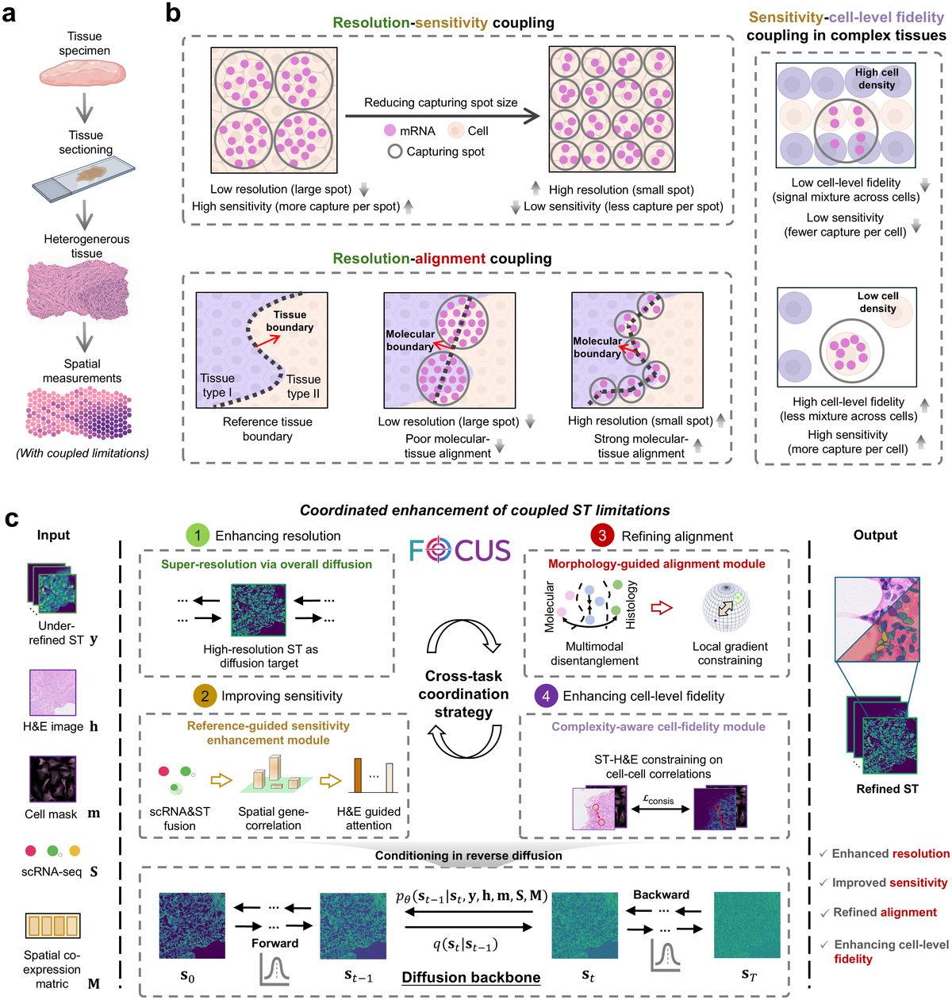

# Coordinated Enhancement of Molecular and Spatial Fidelity for Biological Inference in Spatial Transcriptomics

[](https://www.python.org/downloads/)
[](https://pytorch.org/)
[](LICENSE)

## Overview

Understanding tissue function and pathological states requires resolving the spatial organization of cells and molecular activities. Spatial transcriptomics (ST) enables molecular profiling in situ, but faces measurement trade-offs across spatial resolution, detection sensitivity, molecular-tissue alignment and cell-level fidelity. These limitations are coupled rather than independent: smaller capture units increase spatial resolution but capture fewer transcripts per unit and restrict sensitivity, whereas larger capture units aggregate neighbouring-cell signals, blurring anatomical boundaries and compromising molecular-tissue alignment and cell-level fidelity. Existing computational methods typically target individual aspects in isolation, and independent correction can produce molecular profiles inconsistent with their spatial context.

Here we present FOCUS, a multimodal generative foundation model for coordinated ST enhancement. Built on a conditional diffusion framework with large-scale multimodal training, FOCUS integrates native ST with paired H&E images and cell masks, scRNA-seq references and spatial co-expression priors through selectively activated task-specific modules — reference-guided sensitivity enhancement, morphology-guided alignment and complexity-aware cell-level fidelity — coordinated by a cross-task strategy that compresses the activated modules into task-specific tokens, exchanges them through multi-head cross-attention and converts them into scaling and shifting coefficients (FiLM), so that each module conditions its update on the others.

Trained and evaluated across ten ST platforms, 34 tissue contexts and over 1.7 million tissue patches with more than 5.8 million matched scRNA-seq profiles, FOCUS improved the performance of individual enhancement tasks and provided additional gains when coupled limitations were addressed jointly rather than independently. Across immunology, tissue development and oncology, FOCUS recovered biologically consistent patterns obscured in native ST or isolated enhancement, enabling clearer inference of neutrophil-tumor interactions, spatial osteocyte differentiation and primary-metastatic HNSCC programs.



**Figure 1 | Coupled ST limitations and FOCUS overview.** (**a**) Illustration of spatial gene profiling of heterogeneous tissue. (**b**) Three representative coupled limitations: resolution-sensitivity, resolution-alignment, and sensitivity-cell-level fidelity in cellularly dense tissues. (**c**) FOCUS integrates native ST, paired H&E with cell masks, scRNA-seq references and spatial co-expression priors through task-specific modules, coordinated by a cross-task strategy for joint enhancement of resolution, sensitivity, molecular-tissue alignment and cell-level fidelity.

## Installation

### Environment Setup

Create a conda environment using the provided configuration:

```bash
conda env create -f DDPM310.yaml
conda activate ddpm-nm
```

### Requirements

- Python ≥ 3.10
- PyTorch 2.9.0 (CUDA 12.6)
- Key dependencies:
  - `scanpy` (1.11.5) - ST data processing
  - `anndata` (0.11.4) - Data structures
  - `pot` (0.9.6) - Optimal transport
  - `transformers` (4.57.1) - scGPT integration
  - `timm` (1.0.22) - Vision models
  - `mpi4py` (3.1.3) - Distributed training

All dependencies are specified in `DDPM310.yaml`.

## Data Preparation

### Directory Structure

Organize your data following this structure:

```
data_root/
├── {tissue_type}/
│   ├── {sample_id}/
│   │   ├── HR_ST/
│   │   │   └── extract/{layer}/{patch_id}/
│   │   │       └── HR_ST_256.npz
│   │   ├── spot_ST/
│   │   │   └── extract/{layer}/{patch_id}/
│   │   │       ├── spot_ST.npz
│   │   │       └── scgpt_data/
│   │   ├── WSI/
│   │   │   └── extract/{layer}/{patch_id}/
│   │   │       ├── 5120_to256.npy
│   │   │       ├── 320_to16.npy
│   │   │       ├── cell_mask.npy
│   │   │       └── pre_he.npy
│   │   ├── gene_order.npy
│   │   └── gene_name.txt
│   ├── sc/
│   │   └── {scRNA_data}.h5ad
│   └── coexpression_matrix.npy
```

### Required Files

1. **HR_ST_256.npz**: High-resolution ST data (256×256, sparse format)
2. **spot_ST.npz**: Low-resolution spot data (26×26, sparse format)
3. **5120_to256.npy**: H&E patch at 20× magnification
4. **320_to16.npy**: Multi-scale H&E patches (16×16 grid)
5. **cell_mask.npy**: Cell segmentation masks
6. **pre_he.npy**: Pre-extracted H&E features (512-dim)
7. **scgpt_data/**: scGPT embeddings per gene group
8. **{scRNA_data}.h5ad**: Single-cell reference (AnnData format)
9. **coexpression_matrix.npy**: Gene-gene co-expression matrix
10. **gene_order.npy**: Gene indices for the dataset
11. **gene_name.txt**: Corresponding gene names

### Data Preprocessing

The preprocessing code that turns raw Visium / VisiumHD / Xenium output into the layout above — H&E tile extraction, transcript binning onto the high- and low-resolution grids, and gene panel construction — is in [`data_preprocessing/`](data_preprocessing/). See [`data_preprocessing/README.md`](data_preprocessing/README.md) for the per-platform walkthrough.

Processed data should be log-normalized with gene-wise scaling. For the embedding and feature-extraction steps, please refer to:

- [BioBERT](https://github.com/dmis-lab/biobert) - Gene name embeddings
- [scGPT-spatial](https://github.com/bowang-lab/scGPT-spatial) - Gene expression embeddings
- [Prov-GigaPath](https://github.com/prov-gigapath/prov-gigapath) - H&E feature extraction

### Curated Cross-platform Multimodal Dataset

We provide the processed multimodal data used to train and evaluate FOCUS, so that the full pipeline can be reproduced without re-running the per-platform preprocessing. In total the release covers **6,788 paired ST–H&E images** (over **1.7 million patches**) with matched scRNA-seq references (over **5.8 million cell profiles**) and pre-computed spatial gene co-expression matrices, spanning **ten ST platforms** — eight sequencing-based and two imaging-based — across **17 normal and 17 cancer tissues**.

For every sample the release is organized exactly as the directory structure above, so it can be pointed at directly from `config/config_train.yaml` and `config/config_test.yaml`:

- `HR_ST/` and `spot_ST/` — high- and low-resolution ST, with per-gene-group scGPT embeddings under `scgpt_data/`
- `WSI/` — paired H&E patches at 20× and at multi-scale, cell segmentation masks and pre-extracted H&E features
- `gene_order.npy` / `gene_name.txt` — the gene panel used for each sample
- `sc/{scRNA_data}.h5ad` — the matched single-cell reference for the tissue
- `coexpression_matrix.npy` — the spatial gene–gene co-expression prior

**Download**: [curated cross-platform multimodal datasets](https://www.dropbox.com/scl/fo/8jipnyir34f1farrcgoxk/ADJbjaWY4V2Qv006H7j2j7w?rlkey=ca4buoejjn2d53rqjl5bii7yj&st=i68hdo96&dl=0)

All datasets are derived from public sources; per-sample provenance (platform, tissue, accession) is listed in Supplementary Tables S1–S3 of the paper. The in-house papillary craniopharyngioma (PCP) datasets — Xenium spatial transcriptomics and CODEX spatial proteomics — are deposited in the National Genomics Data Center (NGDC) under accessions **OMIX021475** and **OMIX021470**, respectively, and can be shared for non-commercial academic research in accordance with the applicable data-access requirements.

## Usage

### Training

Configure training parameters in `config/config_train.yaml`:

```yaml
# Key parameters
gene_num: 5         # Genes per training group
batch_size: 8        # Training batch size
SR_times: 10         # Super-resolution factor
epoch: 3000          # Training epochs
lr: 0.0001           # Learning rate
diffusion_steps: 1000
data_root: '/path/to/data/'
log_dir: 'logs/'
```

Launch training:

```bash
python train.py
```

The training script automatically:
- Splits genes into groups of size `gene_num`
- Trains separate models for each gene group
- Saves checkpoints every 2000 steps
- Logs training metrics and loss curves

### Inference

Configure test parameters in `config/config_test.yaml` and run:

```bash
python sample.py
```

Outputs are saved to `TEST_Result-demo/`:
- Predicted gene expression maps (PNG)
- Ground truth comparisons
- Quantitative metrics (CSV): RMSE, SSIM, PCC

### Pre-trained Models

Download pre-trained models from [Dropbox](https://www.dropbox.com/scl/fo/gte7fbz2y14syitka3mb0/AOhsVHx4Rdlk9BU2oJRySv4?rlkey=aytpdtg1ae05jf8i139a2e15c&st=5qi9943t&dl=0).

## Evaluation Metrics

FOCUS is evaluated using:

- **RMSE**: Root mean squared error for intensity accuracy
- **SSIM**: Structural similarity index for spatial patterns
- **PCC**: Pearson correlation coefficient for gene-wise concordance

## Troubleshooting

### Common Issues

1. **CUDA Out of Memory**
   - Reduce `batch_size` in config
   - Use gradient checkpointing: `use_checkpoint: true`
   - Enable mixed precision: `use_fp16: true`

2. **Missing Gene Files**
   - Ensure `gene_order.npy` and `gene_name.txt` exist for each sample
   - Verify gene indices match across ST and scRNA-seq data

3. **Slow Training**
   - Adjust `num_workers` in DataLoader
   - Use SSD storage for data
   - Enable `persistent_workers: true`

4. **NaN Losses**
   - Check input data normalization
   - Verify no inf/nan values in co-expression matrices
   - Reduce learning rate

## Citation

If you use FOCUS in your research, please cite:

```bibtex
@article {Wang2026Focus,
	author = {Wang, Xiaofei and Que, Ningfeng and Liu, Hanyu and Tao, Chenyang and Jiang, Yu and Jiang, Yixuan and Zhu, Pinan and Xu, Jianguo and Yan, Huachao and Ye, Buqing and Price, Stephen and Xi, Jianzhong Jeff and Wang, Xinjie and Li, Chao},
	title = {Coordinated Enhancement of Molecular and Spatial Fidelity for Biological Inference in Spatial Transcriptomics},
	elocation-id = {2025.12.23.696267},
	year = {2026},
	doi = {10.64898/2025.12.23.696267},
}
```

## Data and Code Availability

- **Code**: https://github.com/LHY1007/FOCUS
- **Curated cross-platform multimodal datasets** (paired ST–H&E images, scRNA-seq references, segmented cell masks and pre-computed spatial gene co-expression matrices): [Dropbox](https://www.dropbox.com/scl/fo/8jipnyir34f1farrcgoxk/ADJbjaWY4V2Qv006H7j2j7w?rlkey=ca4buoejjn2d53rqjl5bii7yj&st=i68hdo96&dl=0), with per-sample provenance summarized in Supplementary Tables S1–S3
- **In-house PCP datasets** (Xenium spatial transcriptomics and CODEX spatial proteomics): National Genomics Data Center, accessions OMIX021475 and OMIX021470

## Acknowledgments

FOCUS builds upon several excellent open-source projects:

- **Diffusion Models**: [Improved DDPM](https://github.com/openai/improved-diffusion)
- **BioBERT**: [dmis-lab/biobert](https://github.com/dmis-lab/biobert)
- **scGPT**: [bowang-lab/scGPT-spatial](https://github.com/bowang-lab/scGPT-spatial)
- **GigaPath**: [prov-gigapath/prov-gigapath](https://github.com/prov-gigapath/prov-gigapath)

## Contact

For questions and feedback:
- Open an issue on GitHub
- Email: xw405@cam.ac.uk

---

**Note**: This is research software. While we strive for correctness, please validate results for your specific application. Contributions and feedback are welcome!
